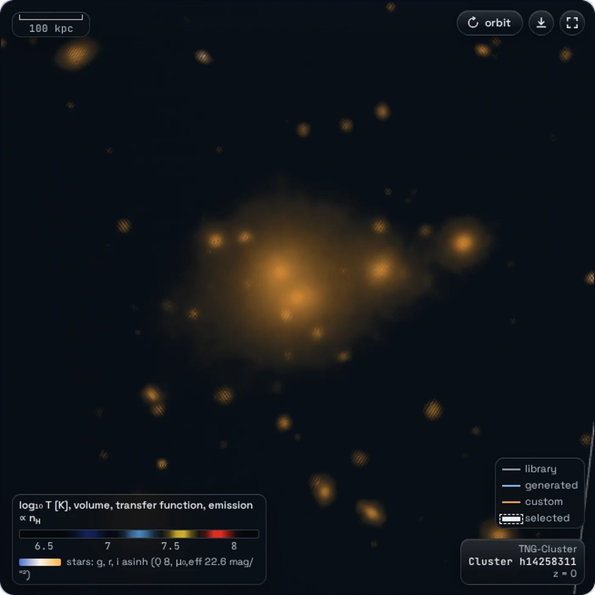
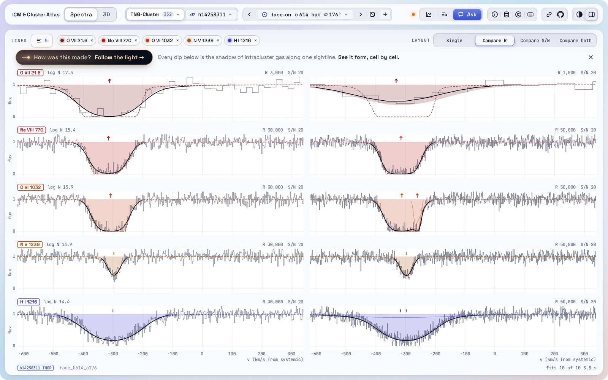
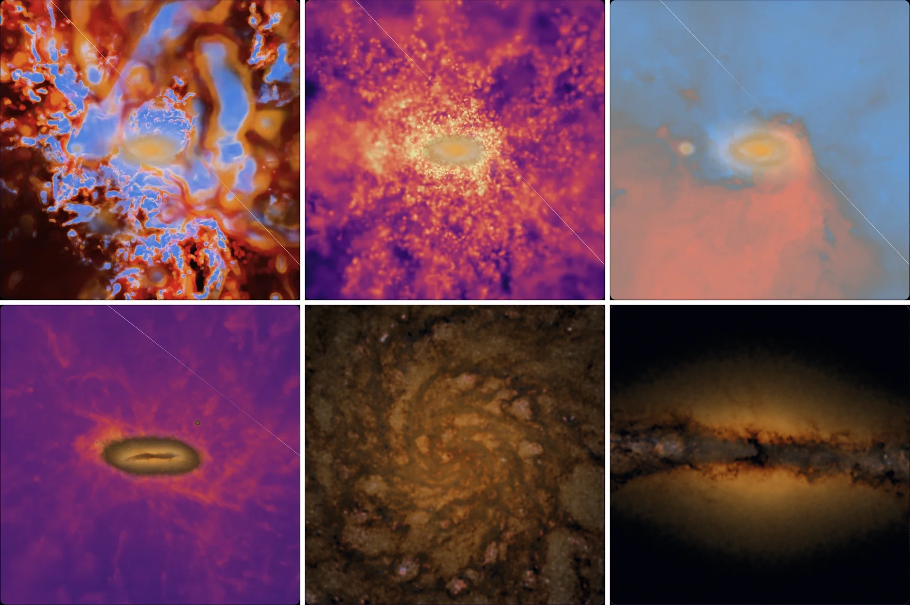
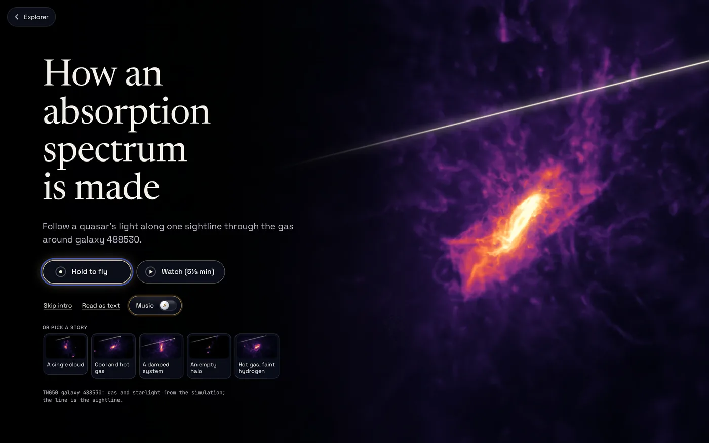
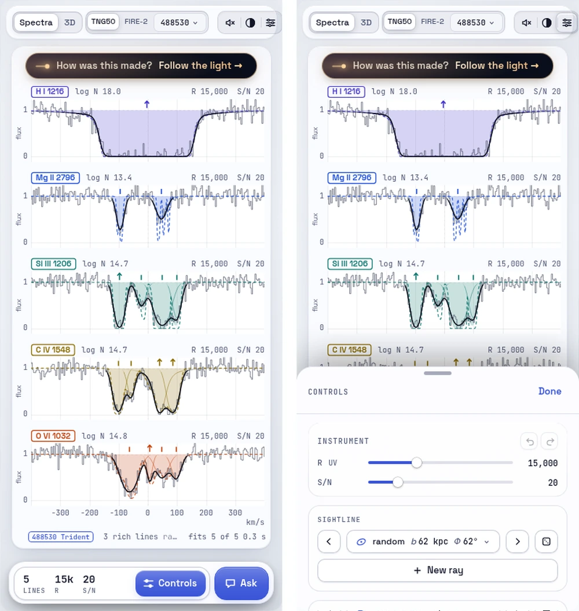

<p align="center">
  <a href="https://icm.tanmaysingh.uk/?g=tngc_h0#tab=3d"></a>
</p>
<p align="center"><sub>Multi-phase intracluster gas across ±4 Mpc (8 Mpc span) rendered live in WebGL2 at <a href="https://icm.tanmaysingh.uk/?g=tngc_h0#tab=3d">icm.tanmaysingh.uk</a>.</sub></p>

> [!NOTE]
> Part of the four-portal **Cross-Scale Cosmic Gas Atlas** ([`ism`](https://ism.tanmaysingh.uk/) &rarr; [`galaxies`](https://galaxies.tanmaysingh.uk/) &rarr; **[`icm`](https://icm.tanmaysingh.uk/)** &rarr; [`igm`](https://igm.tanmaysingh.uk/)). Found a bug or have an idea? Open an [issue](https://github.com/tanmay-starslab/icm-atlas/issues)!

<h1 align="center">Seeing the Intracluster Medium &amp; Massive Galaxy Clusters</h1>

<p align="center"><b>Fly from ±4 Mpc cosmic-web accretion shocks down to 117 pc Brightest Cluster Galaxy (BCG) cores and read 12-ion quasar absorption spectra across 382 simulated galaxy clusters at z = 0.</b></p>

<p align="center">
  <a href="https://icm.tanmaysingh.uk/"><b>Launch the Live 3D ICM &amp; Cluster Atlas &rarr;</b></a>
</p>

<p align="center">
  <a href="https://icm.tanmaysingh.uk/"></a>
  <a href="https://github.com/tanmay-starslab/icm-atlas"></a>
  <a href="https://www.tng-project.org/data/cluster/"></a>
  <a href="http://simba.roe.ac.uk/"></a>
  <a href="https://www.tng-project.org/data/"></a>
  <a href="LICENSE"></a>
</p>

Galaxy clusters are the largest gravitationally bound ecosystems in the Universe. Between hundreds of member galaxies sits the **Intracluster Medium (ICM)**—a $10^7\text{--}10^8\text{ K}$ X-ray-emitting plasma threaded by cool-core multiphase filaments, ram-pressure stripped tails, sloshing cold fronts, AGN jet cavities, and $\pm 4\text{ Mpc}$ cosmic-web accretion shocks. This portal lets you explore **382 massive galaxy clusters and rich groups at $z = 0$** across **TNG-Cluster**, **SIMBA-100**, and **TNG300-1**, pairing a 5-level ($\pm 4\text{ Mpc} \rightarrow \pm 15\text{ kpc}$) WebGL2 3D volumetric ray-marcher with 120-ray, 12-ion UV/EUV/X-ray Voigt absorption spectroscopy.

---

## Cross-Scale Cosmic Gas Ecosystem (`AU` &rarr; `300 Mpc`)

| Scale Regime | Physical Extent | Live Portal | Repository | Astrophysical Focus |
| :--- | :--- | :--- | :--- | :--- |
| **ISM** | $2500\text{ AU} \to 1\text{ kpc}$ | **[`ism.tanmaysingh.uk`](https://ism.tanmaysingh.uk/)** | [`tanmay-starslab/multiphase-ism`](https://github.com/tanmay-starslab/multiphase-ism) | Multiphase interstellar medium &amp; turbulent radiative mixing layers |
| **CGM** | $1\text{ kpc} \to 400\text{ kpc}$ | **[`galaxies.tanmaysingh.uk`](https://galaxies.tanmaysingh.uk/)** | [`tanmay-starslab/cgm-atlas`](https://github.com/tanmay-starslab/cgm-atlas) | Circumgalactic medium across TNG50, FIRE-2, SIMBA, Auriga, AGORA &amp; CAMELS galaxies |
| **ICM** | **$\pm 15\text{ kpc} \to \pm 4\text{ Mpc}$** | **[`icm.tanmaysingh.uk`](https://icm.tanmaysingh.uk/)** | **[`tanmay-starslab/icm-atlas`](https://github.com/tanmay-starslab/icm-atlas)** | **Intracluster medium &amp; BCG cores across 382 massive galaxy clusters ($z=0$)** |
| **IGM** | $35\text{ Mpc} \to 302.6\text{ Mpc}$ | **[`igm.tanmaysingh.uk`](https://igm.tanmaysingh.uk/)** | [`tanmay-starslab/igm-atlas`](https://github.com/tanmay-starslab/igm-atlas) | Intergalactic medium &amp; whole-box cosmic web across 6 flagship cosmological boxes |

---

## Interactive Deep-Link Showcase

Click any link below to jump straight into a live 3D volume or multi-ion absorption sightline in your browser:

- **[`TNG-Cluster` Most Massive Halo (`tngc_h14258311` / `tngc_h0`, $\log M_{200c} = 15.38$) — Live 3D $\pm 4\text{ Mpc}$ Volume](https://icm.tanmaysingh.uk/?g=tngc_h0#tab=3d)**
- **[`TNG-Cluster` `tngc_h14258311` — 12-Ion THOR Voronoi + CLOUDY FG11 Absorption Spectra](https://icm.tanmaysingh.uk/?g=tngc_h14258311#tab=spectra)**
- **[`SIMBA-100` Massive Cluster `C01 (h0)` (`simba100_c01_h0`, $\log M_{200c} = 15.05$) — Two-Mode AGN Jet Feedback](https://icm.tanmaysingh.uk/?g=simba100_c01_h0)**
- **[`SIMBA-100` Cluster `C01 (h0)` — Live 3D $\pm 4\text{ Mpc}$ ICM &amp; BCG Volume](https://icm.tanmaysingh.uk/?g=simba100_c01_h0#tab=3d)**
- **[`TNG300-1` Cluster `1338052` (`tng300_sub1338052`) — 120-Ray THOR Sightlines &amp; Voigt Fits](https://icm.tanmaysingh.uk/?g=tng300_sub1338052)**
- **[`TNG300-1` Cluster `1338052` — Live 3D $\pm 4\text{ Mpc}$ Volume](https://icm.tanmaysingh.uk/?g=tng300_sub1338052#tab=3d)**
- **[How an Absorption Spectrum is Made — Interactive Cell-by-Cell Explainer](https://icm.tanmaysingh.uk/learn/how-a-spectrum-is-made/)**
- **[Detect &amp; Resolve — Spectrograph $R$ and $\text{S/N}$ Requirements Matrix](https://icm.tanmaysingh.uk/detect/)**

---

## Visual Tour

### Read the Light Across 12 UV, EUV &amp; X-Ray Transitions

<p align="center"><a href="https://icm.tanmaysingh.uk/"></a></p>
<p align="center"><sub>Twelve ions from cool H I 1216 and Mg II 2796 to hot coronal Ne VIII 770 and X-ray O VII 21.6 Å along 120 sightlines per cluster, degraded and Voigt-fitted live in your browser.</sub></p>

### Fly Through 5 Nested 3D Octree Levels ($\pm 4\text{ Mpc} \rightarrow \pm 15\text{ kpc}$)

<p align="center"><a href="https://icm.tanmaysingh.uk/?g=tngc_h0#tab=3d"></a></p>
<p align="center"><sub>Column-integral and 1D/2D transfer-function volume rendering across 18 gas/ion/kinematic fields (`nH`, `T`, `Z`, 12 ions, and 5 velocity moments `vlos`, `vr`, `vphi`, `vmag`, `sigmalos`) plus `S0..S4` BCG &amp; satellite starlight.</sub></p>

### Watch a Spectrum Form &amp; Take It Anywhere

<table>
  <tr>
    <td width="50%"><a href="https://icm.tanmaysingh.uk/learn/how-a-spectrum-is-made/"></a></td>
    <td width="50%"><a href="https://icm.tanmaysingh.uk/"></a></td>
  </tr>
</table>
<p align="center"><sub>Left: interactive step-by-step physical explainer. Right: responsive mobile UI (`390×844`) with the liquid-metal simulation picker pill (`#top-sim`) and non-modal bottom control sheet.</sub></p>

---

## 382-Cluster Multi-Simulation Suite ($z = 0$)

| Simulation Suite | Clusters | Hydrodynamics &amp; Feedback | Halo Mass Range ($M_{200c}$) | Radial Extent | Sightlines / Cluster | Primary Reference |
| :--- | :---: | :--- | :---: | :---: | :---: | :--- |
| **`TNG-Cluster`** | **352** | AREPO moving-mesh MHD, kinetic + thermal SMBH feedback ($1\text{ Gpc}^3$ parent zoom-ins) | $10^{14.0}\text{--}10^{15.4}\,M_\odot$ | $\pm 4000\text{ kpc}$ (`L0..L4`) | 120 rays (`THOR` + `CLOUDY FG11`) | [Nelson et al. (2024), *A&amp;A* 686, A157](https://doi.org/10.1051/0004-6361/202348608) |
| **`SIMBA-100`** | **10** | GIZMO meshless finite-mass (MFM), two-mode bipolar AGN jet + radiative/X-ray feedback ($100\,h^{-1}\text{ Mpc}$) | $10^{14.4}\text{--}10^{15.1}\,M_\odot$ | $\pm 4000\text{ kpc}$ (`L0..L4`) | 120 rays (`Trident HM2012`) | [Davé et al. (2019), *MNRAS* 486, 2827](https://doi.org/10.1093/mnras/stz937) |
| **`TNG300-1`** | **20** | AREPO moving-mesh MHD ($302.6\text{ Mpc}$ uniform box) | $10^{13.8}\text{--}10^{15.2}\,M_\odot$ | $\pm 4000\text{ kpc}$ (`L0..L4`) | 120 rays (`THOR` + `CLOUDY FG11`) | [Pillepich et al. (2018)](https://doi.org/10.1093/mnras/stx3112); [Nelson et al. (2019)](https://doi.org/10.1186/s40668-019-0028-x) |
| **Total** | **382** | **3 Flagship Cosmological Suites** | **$10^{13.8}\text{--}10^{15.4}\,M_\odot$** | **$8.0\text{ Mpc} \to 30\text{ kpc}$** | **45,840 sightlines** | **549,120 synthetic ion spectra** |

---

## 5-Level 3D ICM Volumetric Octree ($\pm 4\text{ Mpc} \rightarrow \pm 15\text{ kpc}$) &amp; 12-Ion THOR Voigt Methodology

Every cluster's Voronoi cells or SPH particles are deposited using a mass-conserving 3D kernel into **five nested $256^3$ octree levels** (`tng50-viz/2` schema) and ray-marched in a single scale-aware WebGL2 GLSL3 pass (`boxScale = H0 / 400 = 10` for $H_0 = 4000\text{ kpc}$, no radial mask cutoff):

| Octree Level | Half-Extent ($H_l$) | Full Box Width | Voxel Size ($256^3$) | Physical Regime Probed |
| :---: | :---: | :---: | :---: | :--- |
| **`L0` / `S0`** | $\pm 4000\text{ kpc}$ | $8.0\text{ Mpc}$ | $31.25\text{ kpc}$ | Accretion shocks, cosmic-web filament funnels &amp; splashback zone ($2\text{--}3\,R_{200c}$) |
| **`L1` / `S1`** | $\pm 1000\text{ kpc}$ | $2.0\text{ Mpc}$ | $7.81\text{ kpc}$ | Bulk virialized Intracluster Medium ($R_{200c}$), substructure &amp; infalling groups |
| **`L2` / `S2`** | $\pm 250\text{ kpc}$ | $500\text{ kpc}$ | $1.95\text{ kpc}$ | Sloshing cold fronts, ram-pressure stripped jellyfish tails &amp; intracluster light |
| **`L3` / `S3`** | $\pm 62.5\text{ kpc}$ | $125\text{ kpc}$ | $488\text{ pc}$ | Circum-BCG multiphase cooling filaments &amp; X-ray AGN cavity rims |
| **`L4` / `S4`** | $\pm 15.0\text{ kpc}$ | $30\text{ kpc}$ | $117\text{ pc}$ | Brightest Cluster Galaxy (BCG) core, cold molecular/atomic gas &amp; 3D dust lanes |

### 12-Ion Sightline Synthesis &amp; In-Browser Voigt Fitting

1. **Voronoi Mesh Ray-Tracing (`THOR` + `CLOUDY FG11`) &amp; `Trident HM2012`:**
   - Each cluster carries a 120-ray library spanning face-on (along the cluster principal axis), edge-on (across the cluster midplane), and random orientations over impact parameters $b \in [0, 4000]\text{ kpc}$.
   - Exact cell intersections through the native Voronoi tessellation are traced with **THOR** ([Byrohl &amp; Nelson 2025](https://arxiv.org/abs/2507.11603)), using **CLOUDY** ([Ferland et al. 2017](https://doi.org/10.1093/mnras/stx1661)) **FG11** UV/X-ray background tables ([Faucher-Giguère et al. 2009](https://doi.org/10.1088/0004-637X/703/2/1416)) and [Rahmati et al. (2013)](https://doi.org/10.1093/mnras/stt066) $\text{H I}$ self-shielding (plus **Trident** [Hummels et al. 2017](https://doi.org/10.3847/1538-4357/aa7e2d) with **HM2012** [Haardt &amp; Madau 2012](https://doi.org/10.1088/0004-637X/746/2/125) for `SIMBA-100`).
2. **12 Diagnostic Transitions (`tngsight/ions.json`):**
   - **Cool / Neutral &amp; Low Ions ($T \sim 10^4\text{ K}$):** $\text{H I } 1216\text{ \AA}$, $\text{Mg II } 2796\text{ \AA}$, $\text{Si II } 1260\text{ \AA}$, $\text{C II } 1335\text{ \AA}$.
   - **Intermediate Ions ($T \sim 10^{4.3}\text{--}10^5\text{ K}$):** $\text{Si III } 1206\text{ \AA}$, $\text{C III } 977\text{ \AA}$, $\text{Si IV } 1403\text{ \AA}$, $\text{C IV } 1548\text{ \AA}$.
   - **Warm-Hot &amp; Coronal X-Ray Ions ($T \sim 10^{5.3}\text{--}10^7\text{ K}$):** $\text{N V } 1239\text{ \AA}$, $\text{O VI } 1032\text{ \AA}$, $\text{Ne VIII } 770\text{ \AA}$ (EUV), and $\text{O VII } 21.602\text{ \AA}$ (soft X-ray).
3. **In-Browser Instrumental Degradation &amp; Levenberg–Marquardt Voigt Fitter:**
   - Convolve any sightline in real time with a Gaussian line-spread function ($\text{FWHM} = c/R$, $R \in [5000, 150000]$ for UV/EUV and $[100, 5000]$ for X-ray) and continuum signal-to-noise $\text{S/N} \in [2, 100]$.
   - Toggle **Fitted components** to run a Web Worker Levenberg–Marquardt Voigt fitter (`docs/js/fitworker.js`) seeded from the intrinsic component catalog and pruned by $\Delta\text{BIC}$, with automatic lower-limit flagging for saturated troughs.
4. **Client-Side 3D Ray Casting (`Rust/WASM` + JS):**
   - Cast custom sightlines directly through the 5-level 3D ion &amp; velocity cubes in your browser via **New ray** or **Pick ray** on the 3D stage (`docs/js/fast_viz.wasm`).

---

## Public Hugging Face Dataset Shards

All 382 clusters' 120-ray spectral libraries and 5-level $256^3$ 3D volumetric WebP texture atlases are hosted on public Hugging Face datasets and streamed on demand with HTTP range/cache support:

| Hugging Face Dataset | Contents | Clusters Hosted | Format &amp; Schema |
| :--- | :--- | :--- | :--- |
| **[`tanmay-starslab/icm-atlas-web-0`](https://huggingface.co/datasets/tanmay-starslab/icm-atlas-web-0)** | 120-ray spectra, Voigt components, sightline &amp; halo metadata | Shard 0 (`TNG-Cluster` batch 0 + all 10 `SIMBA-100` + all 20 `TNG300-1`) | `catalog.json`, `components.json`, `galaxy.json`, `s/*.bin` (`TNGS v2`), `viz/manifest_v2.json` |
| **[`tanmay-starslab/icm-atlas-web-1`](https://huggingface.co/datasets/tanmay-starslab/icm-atlas-web-1)** | 120-ray spectra, Voigt components, sightline &amp; halo metadata | Shard 1 (`TNG-Cluster` batch 1) | `catalog.json`, `components.json`, `galaxy.json`, `s/*.bin` (`TNGS v2`), `viz/manifest_v2.json` |
| **[`tanmay-starslab/icm-atlas-3d-0`](https://huggingface.co/datasets/tanmay-starslab/icm-atlas-3d-0)** | 5-level ($256^3$) 3D gas, 12-ion, 3D velocity &amp; `S0..S4` starlight cubes | Shard 0 (`TNG-Cluster` batch 0 + all 10 `SIMBA-100` + all 20 `TNG300-1`) | Lossless 4-part WebP 3D atlases (`tng50-viz/2`, `L0..L4` &amp; `S0..S4`) |
| **[`tanmay-starslab/icm-atlas-3d-1`](https://huggingface.co/datasets/tanmay-starslab/icm-atlas-3d-1)** | 5-level ($256^3$) 3D gas, 12-ion, 3D velocity &amp; `S0..S4` starlight cubes | Shard 1 (`TNG-Cluster` batch 1) | Lossless 4-part WebP 3D atlases (`tng50-viz/2`, `L0..L4` &amp; `S0..S4`) |

---

## Local Development, Building &amp; Testing

Both `docs/` (served at root `/` by GitHub Pages for `https://icm.tanmaysingh.uk/`) and `docs/tng50/` are kept 100% synchronized by `deploy/data/build_icm_catalog.py`:

```bash
# 1. Rebuild the 382-cluster catalog, render docs/tng50/index.html, run scripts/build_site.mjs,
#    and synchronize docs/ and docs/tng50/
python3 deploy/data/build_icm_catalog.py

# 2. Run the Node.js unit test suite (pivot, galaxies, vizdata, TF, degradation, Voigt fitting)
node tests/js/pivot_unit.mjs
node tests/js/galaxies_unit.mjs
node tests/js/vizdata_unit.mjs

# 3. Serve locally and open http://127.0.0.1:8000/
python3 -m http.server 8000 --directory docs
```

---

## Credits &amp; License

- **Code:** Released under the [MIT License](LICENSE) (© 2026 Tanmay Singh). Third-party notices are documented in [`THIRD_PARTY_LICENSES`](THIRD_PARTY_LICENSES).
- **Simulations:**
  - **TNG-Cluster &amp; TNG300-1:** IllustrisTNG Collaboration ([Nelson et al. 2024, *A&amp;A* 686, A157](https://doi.org/10.1051/0004-6361/202348608); [Nelson et al. 2019, *ComAC* 6, 2](https://doi.org/10.1186/s40668-019-0028-x); [Pillepich et al. 2018, *MNRAS* 475, 648](https://doi.org/10.1093/mnras/stx3112); [Springel et al. 2018, *MNRAS* 475, 676](https://doi.org/10.1093/mnras/stx3304)).
  - **SIMBA-100:** SIMBA Collaboration ([Davé et al. 2019, *MNRAS* 486, 2827](https://doi.org/10.1093/mnras/stz937)).
- **Ray-Tracing, Ionisation &amp; 3D Rendering:**
  - **THOR:** [Byrohl &amp; Nelson (2025), arXiv:2507.11603](https://arxiv.org/abs/2507.11603).
  - **CLOUDY &amp; UV Background:** [Ferland et al. (2017)](https://doi.org/10.1093/mnras/stx1661); [Faucher-Giguère et al. (2009)](https://doi.org/10.1088/0004-637X/703/2/1416); [Rahmati et al. (2013)](https://doi.org/10.1093/mnras/stt066).
  - **Trident &amp; yt:** [Hummels, Smith &amp; Silvia (2017), *ApJ* 847, 59](https://doi.org/10.3847/1538-4357/aa7e2d); [Turk et al. (2011), *ApJS* 192, 9](https://doi.org/10.1088/0067-0049/192/1/9); [Haardt &amp; Madau (2012), *ApJ* 746, 125](https://doi.org/10.1088/0004-637X/746/2/125).
